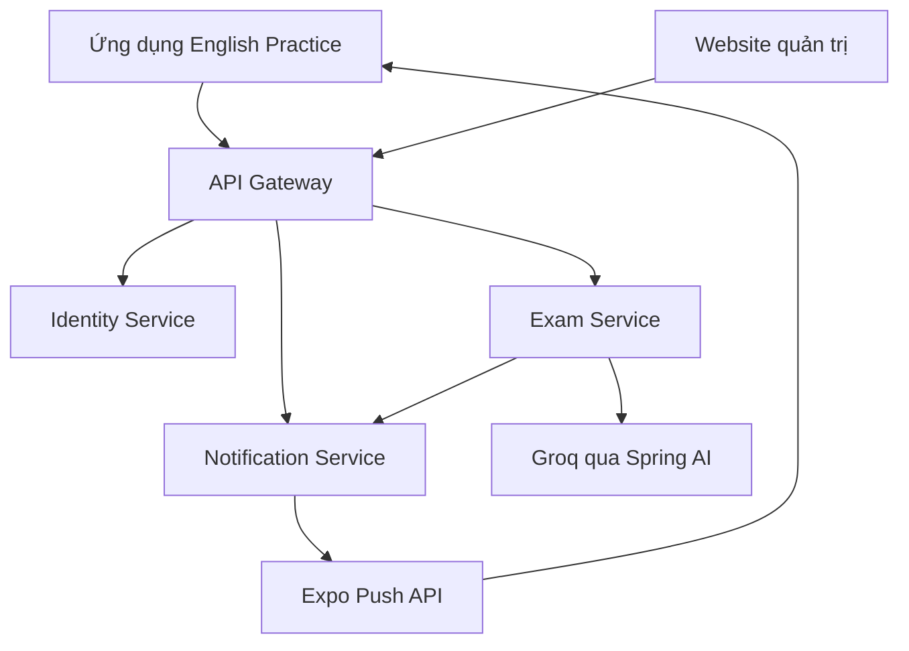

# Nhóm 6 · Đồ án Lập trình cho thiết bị di động

**Trường Đại học Công nghiệp Thành phố Hồ Chí Minh (IUH)**

**Khoa Công nghệ Thông tin**

| Thông tin | Nội dung |
| --- | --- |
| Môn học | Lập trình cho thiết bị di động |
| Giảng viên hướng dẫn | Nguyễn Vũ Lâm |
| Lớp | DHKTPM19A |
| Mã lớp học phần | 420300143201 |
| Nhóm thực hiện | Nhóm 6 |
| Đề tài số 1 | Trợ lý học tập theo ngữ cảnh — English Practice |
| Thời gian báo cáo | Tháng 11 năm 2026 |

## Thành viên và phân công

| MSSV | Họ và tên | Công việc phụ trách |
| --- | --- | --- |
| 23633961 | **Nguyễn Công Tuyến — Nhóm trưởng** | Tài khoản và xác thực; Identity Service, xác thực tại API Gateway; đăng nhập Google, quản lý phiên và token; tích hợp các module, tài liệu và build ứng dụng. |
| 23636821 | **Đỗ Hoài Nhớ** | Luyện TOEIC và gia sư AI; đề thi, câu hỏi, audio, chấm bài và lịch sử; giao diện làm bài, chat và gửi ảnh; triển khai backend bằng Docker trên Render và kết nối cơ sở dữ liệu Aiven. |
| 23635991 | **Tô Nguyễn An Thuyên** | Kế hoạch, nhiệm vụ và phiên học; từ vựng, lịch ôn và push notification; giao diện Trang chủ, kế hoạch học, ôn tập và các cài đặt liên quan. |

## English Practice


**Ứng dụng quản lý kế hoạch học, luyện TOEIC và gia sư AI.**

English Practice hỗ trợ sinh viên và người đi làm tự học tiếng Anh trên thiết bị di động. Ứng dụng kết nối các hoạt động lập kế hoạch, theo dõi thời gian học, luyện Listening/Reading, lưu từ vựng và hỏi đáp với gia sư AI trong cùng một nơi.

Repository này chứa **mã nguồn ứng dụng di động**. Backend và website quản trị được phát triển trong các repository riêng, liên kết ở cuối trang.

## Chức năng chính

| Nhóm chức năng | Nội dung |
| --- | --- |
| Tài khoản | Đăng ký, đăng nhập bằng tài khoản hoặc Google; khôi phục phiên, đăng xuất, cập nhật hồ sơ và đổi mật khẩu. |
| Trang chủ | Xem buổi học hôm nay, tiến độ và thời gian học gần đây; truy cập các bộ đề TOEIC. |
| Kế hoạch và phiên học | Thiết lập mục tiêu và lịch học; xem nhiệm vụ theo tuần; bắt đầu, tạm dừng, tiếp tục và kết thúc phiên học. |
| Luyện TOEIC | Chọn năm, đề và phần thi; luyện Listening/Reading, nộp bài, xem kết quả và lịch sử làm bài. Chế độ khách hỗ trợ luyện tập mà không lưu lịch sử vào tài khoản. |
| Từ vựng | Tra cứu, lưu và xóa từ; nghe phát âm; chọn từ để tạo lịch ôn và ôn bằng flashcard. |
| Gia sư AI | Hỏi đáp bằng văn bản hoặc ảnh chụp/ảnh từ thư viện; nhận giải thích và xem lại lịch sử hội thoại. |
| Cài đặt và nhắc học | Chọn giao diện sáng/tối/theo hệ thống; cấu hình nhắc học và giờ yên lặng; quản lý quyền thông báo. |

Giao diện gồm năm tab: **Trang chủ · Gia sư AI · Học tập · Từ vựng · Cài đặt**.

### Hỗ trợ học theo ngữ cảnh

Theo thiết kế trong báo cáo, backend sử dụng kết quả luyện tập và hoạt động học gần đây để điều chỉnh nhiệm vụ: ưu tiên phần Reading còn yếu và điều chỉnh thời lượng khi người học bỏ lỡ nhiều buổi. Việc điều chỉnh kế hoạch được thực hiện bằng quy tắc nghiệp vụ; gia sư AI hỗ trợ giải thích và hỏi đáp.

Kết quả luyện đề được backend chấm theo đáp án đã lưu. Số câu đúng **chưa phải điểm TOEIC quy đổi theo thang 990**.

## Công nghệ sử dụng

| Thành phần | Công nghệ |
| --- | --- |
| Ứng dụng di động | React Native 0.86.3, Expo SDK 57, React 19.2.3, TypeScript 6 |
| Điều hướng và giao diện | Expo Router, Tamagui, hệ thống theme sáng/tối |
| Kết nối API | Axios; access token, refresh token và xử lý phiên hết hạn |
| Lưu trữ trên thiết bị | Expo SecureStore cho token trên Android/iOS; AsyncStorage cho cài đặt |
| Tính năng thiết bị | Expo Audio, ImagePicker, FileSystem, Notifications, Speech |
| Backend | Java 21, Spring Boot, Spring Cloud Gateway, Spring Security, JPA/Hibernate |
| Gia sư AI | Spring AI tích hợp Groq qua API tương thích OpenAI; khóa truy cập được quản lý tại backend |
| Website quản trị | React, Vite, React Router, Redux Toolkit, Axios |
| Triển khai | EAS Build/EAS Update cho mobile; Docker và Render hoặc máy chủ nhóm qua Tailscale Funnel cho backend |

Thông tin backend và website quản trị được tóm tắt từ báo cáo của nhóm. Môi trường máy chủ nhóm sử dụng SQL Server; nhánh backend `render-free-deploy` sử dụng cơ sở dữ liệu Aiven qua MariaDB Connector/J.

## Kiến trúc hệ thống



- **Identity Service:** tài khoản, xác thực, hồ sơ và vòng đời phiên đăng nhập.
- **Exam Service:** đề TOEIC, chấm bài, kết quả, kế hoạch, phiên học, từ vựng và hội thoại AI.
- **Notification Service:** đăng ký thiết bị và gửi nhắc học qua Expo Push API.
- **API Gateway:** điểm truy cập chung của frontend, định tuyến yêu cầu và kiểm tra xác thực.

## Cấu trúc mã nguồn

```text
features/
  ai/                 Gia sư AI và lịch sử hội thoại
  auth/               Đăng nhập, đăng ký và Google Sign-In
  home/               Trang chủ và thông tin học tập
  notifications/      Đăng ký thiết bị nhận thông báo
  settings/           Hồ sơ, giao diện và nhắc học
  study/              TOEIC, kế hoạch và phiên học
  vocabulary/         Từ vựng và lịch ôn
src/
  app/                Các route và layout của Expo Router
  components/         Thành phần giao diện dùng chung
  lib/                Axios, xác thực và quản lý phiên
  providers/          Context và các provider dùng chung
  theme/              Màu sắc, tokens và theme
assets/               Hình ảnh, biểu tượng và font
```

## Cài đặt và chạy ứng dụng

### 1. Chuẩn bị

- Node.js từ **22.13.x** trở lên, npm và Git; xem [yêu cầu Expo SDK 57](https://docs.expo.dev/versions/v57.0.0/).
- Điện thoại Android hoặc máy ảo Android có Google Play Services nếu sử dụng đăng nhập Google.
- Backend đang hoạt động, có dữ liệu đề thi và địa chỉ API Gateway truy cập được từ thiết bị.
- Development build của ứng dụng. Google Sign-In native trong dự án cần development build, không chạy đầy đủ bằng Expo Go.

### 2. Lấy mã nguồn và cài thư viện

```bash
git clone https://github.com/thuyenvie/mobile-app-english-practice-iuh.git
cd mobile-app-english-practice-iuh
npm ci
```

### 3. Cấu hình môi trường

Tạo `.env` từ [.env.example](.env.example), rồi thay các giá trị mẫu theo môi trường của nhóm. Trên PowerShell, nếu chưa có `.env`:

```powershell
Copy-Item .env.example .env
```

| Biến | Mục đích |
| --- | --- |
| `EXPO_PUBLIC_API_BASE_URL` | Địa chỉ API Gateway, bao gồm hậu tố `/api`. |
| `EXPO_PUBLIC_GOOGLE_WEB_CLIENT_ID` | OAuth Client ID loại Web application; cần thống nhất với cấu hình xác thực Google ở backend. |
| `EXPO_PUBLIC_GOOGLE_IOS_CLIENT_ID` | Client ID riêng khi cấu hình đăng nhập Google trên iOS. |
| `EXPO_PUBLIC_GOOGLE_ANDROID_CLIENT_ID` | Giá trị tùy chọn phục vụ kiểm tra cấu hình; không thay cho Web Client ID. |

Với Android Emulator và backend chạy trên máy tính, địa chỉ mẫu là `http://10.0.2.2:9999/api`. Với điện thoại thật, dùng địa chỉ LAN hoặc HTTPS mà điện thoại truy cập được. `.env.local`, nếu có, có thể ghi đè giá trị trong `.env`.

Không đưa private key, client secret, khóa AI hoặc thông tin xác thực backend vào `EXPO_PUBLIC_*`: các giá trị này có thể xuất hiện trong app đã build. Các file môi trường riêng và khóa bí mật được loại khỏi Git bằng `.gitignore`. Xem [hướng dẫn biến môi trường Expo](https://docs.expo.dev/guides/environment-variables/#security-considerations).

### 4. Cài development build và khởi động

Nếu nhóm đã cung cấp development build phù hợp, cài bản đó lên thiết bị. Nếu cần tạo bản mới, tài khoản Expo phải có quyền đối với project đang liên kết trong `app.json`:

```bash
npx eas-cli@latest login
npx eas-cli@latest build --platform android --profile development
```

Sau khi cài development build, chạy:

```bash
npm start
```

Nhấn `a` để mở trên máy ảo Android hoặc quét mã QR để mở trên điện thoại. Có thể dùng `npm run android` để khởi động Metro và mở Android. Xem thêm [hướng dẫn development build của Expo](https://docs.expo.dev/develop/development-builds/use-development-builds/).

Khi build APK demo, profile `preview`/`apk` trong `eas.json` hiện cấu hình riêng địa chỉ API của nhóm. Cần kiểm tra giá trị đó trước khi build cho một môi trường khác.

## Kiểm tra mã nguồn

```bash
npm run lint
npm run typecheck
```

## Liên kết sản phẩm

- [Mã nguồn ứng dụng di động](https://github.com/thuyenvie/mobile-app-english-practice-iuh)
- [Mã nguồn backend](https://github.com/hoainho359/english-practice)
- [Mã nguồn website quản trị](https://github.com/hoainho359/font-english-practice)
- [Thiết kế Figma của Nhóm 6](https://www.figma.com/design/rT0Rmb3NVoPRQYkdEU4fMq/Nh%C3%B3m-6_Mobile?node-id=137-36)
- [Thư mục APK được cung cấp trong báo cáo](https://drive.google.com/drive/folders/1rc0WTtqrxuvH0cC42eAINNUQcHl4iMtd)

## Giới hạn hiện tại và hướng phát triển

Ứng dụng cần kết nối mạng cho các chức năng sử dụng backend và AI; chưa có chế độ học ngoại tuyến đầy đủ. Bản demo qua Tailscale Funnel phụ thuộc máy chủ nhóm đang hoạt động. Chức năng giữa nhánh phát triển và nhánh triển khai Render có thể khác nhau; khi nghiệm thu cần sử dụng đúng cặp backend và APK.

Gia sư AI cung cấp nội dung hỗ trợ học tập, có thể trả lời chưa chính xác. Người học cần đối chiếu với đáp án và học liệu. Hiệu quả cải thiện kết quả học tập chưa được xác nhận bằng nghiên cứu người dùng có số liệu đầy đủ.

Nhóm định hướng tiếp tục cải thiện độ ổn định khi chuyển mạng, đồng bộ các môi trường triển khai, bổ sung lưu trữ audio bền vững, hoàn thiện kiểm thử và mở rộng khả năng học ngoại tuyến.
